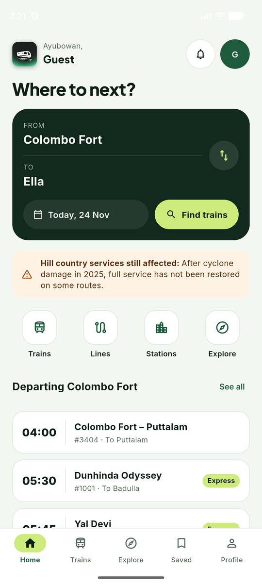
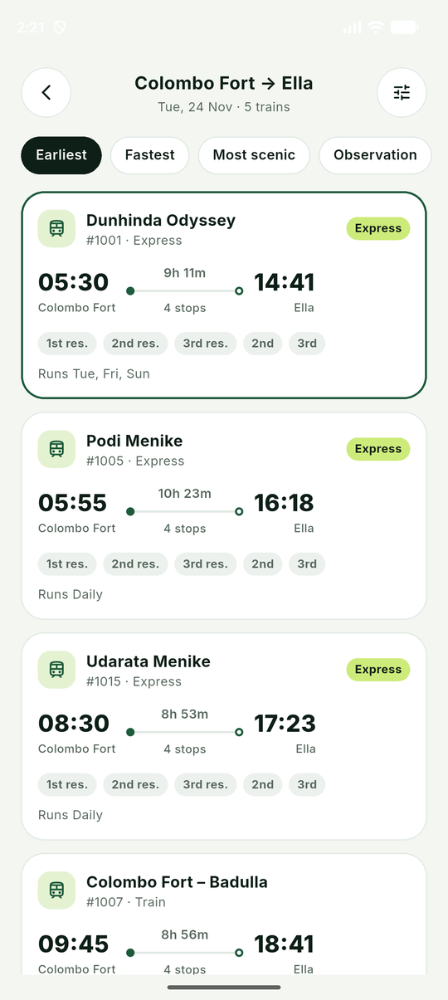
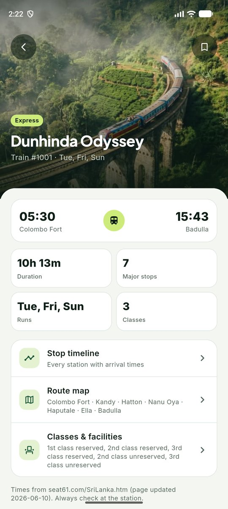
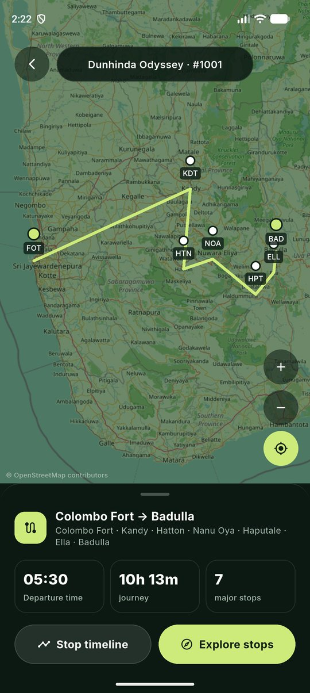
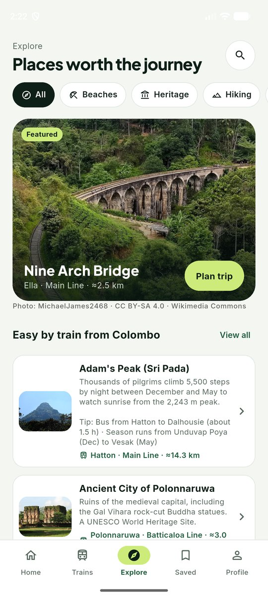
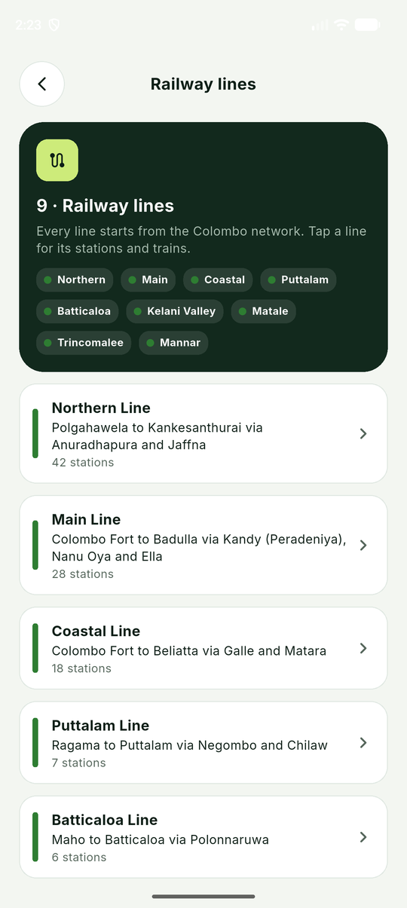
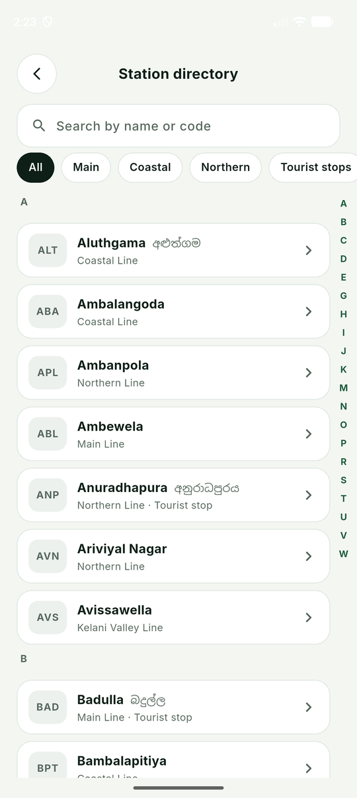

# CeylonGO

**Explore Sri Lanka. Travel by train.**

CeylonGO is a railway companion for Sri Lanka, built for both local passengers and visitors. It puts train schedules, station information, route maps and places worth visiting in one app, in English and Sinhala.

## Features

- **Journey search**: pick a departure and arrival station and a date, then sort trains by earliest, fastest or most scenic, or show only those with an observation car.
- **Train details**: departure and arrival times, journey length, the days the train runs, seat classes and a stop-by-stop timeline.
- **Route maps**: each train's route drawn on an OpenStreetMap map, with its major stops marked.
- **Railway lines**: all 9 lines (Main, Coastal, Northern, Puttalam, Kelani Valley and more) with their stations and trains.
- **Station directory**: 113 stations, searchable by name or code, with a filter for tourist stops and a list of stations near you.
- **Explore**: destinations reachable by train, such as Nine Arch Bridge, Adam's Peak and Polonnaruwa, each with photos, travel tips and the nearest station.
- **Service notices**: announcements about disruptions, such as hill-country routes still affected by cyclone damage.
- **Saved items**: bookmark trains and destinations.
- **Personal settings**: home station, English or Sinhala (සිංහල), light, dark or system theme, and notification preferences. Settings are kept on the device.
- **Accounts are optional**: sign in or continue as a guest.
- **Help & feedback**: send feedback from inside the app.

## Future enhancements

### Ticket booking through Sri Lanka Railways

The main planned addition is booking tickets inside CeylonGO, connected to the Sri Lanka Railways reservation system, so a traveller can go from finding a train to holding a ticket without leaving the app.

Planned scope:

- **Book from search results**: pick a train, class and number of passengers, and reserve straight from the journey results or the train details screen.
- **Live seat availability**: show real availability by class (such as 1st class, 2nd class reserved and observation car) instead of the static class list.
- **Passenger details and payment**: collect passenger details once, and pay in the app with the payment methods Sri Lanka Railways supports.
- **My tickets**: keep confirmed tickets in the app with a QR code or booking reference, available offline at the station.
- **Changes and cancellations**: view a booking, cancel it or change the date, following the railway's own refund rules.
- **Booking notifications**: booking confirmation, a reminder before departure, and alerts if the booked train is delayed or cancelled, reusing the existing service notices.
- **Sinhala and English**: the whole booking flow in both languages, like the rest of the app.

This depends on Sri Lanka Railways, because CeylonGO is not an official app today (see the note in the app's About screen). It needs an official partnership and API access to the reservation system, and booking will only be switched on once that exists. Until then, CeylonGO stays a schedule and travel guide, and the booking screens will not appear. Passenger and payment data must be handled under the railway's requirements and Sri Lankan data protection rules, with card details never stored by CeylonGO.

## Screenshots

| Home | Search results | Train details |
|:---:|:---:|:---:|
|  |  |  |

| Route map | Explore | Railway lines |
|:---:|:---:|:---:|
|  |  |  |

| Station directory |
|:---:|
|  |

## Built with

| Area | Technology |
|---|---|
| App | [Flutter](https://flutter.dev) (Dart 3.14+) for Android and iOS |
| State management | [Riverpod](https://riverpod.dev) |
| Navigation | [go_router](https://pub.dev/packages/go_router) |
| Backend | [Supabase](https://supabase.com) (Postgres, auth, storage) |
| Maps | [flutter_map](https://pub.dev/packages/flutter_map) with OpenStreetMap tiles |
| Languages | Flutter `gen-l10n` (English and Sinhala) |
| Fonts | Plus Jakarta Sans, Inter, Noto Sans Sinhala |

## Getting started

### Requirements

- Flutter SDK (stable channel) with Dart 3.14 or newer
- Android Studio with an emulator, or a physical Android device
- Xcode, for iOS builds on macOS

### Run the app

```bash
git clone https://github.com/DuminduMalinga/Lanka_Raill.git
cd Lanka_Raill
flutter pub get
flutter run
```

The app connects to the project's Supabase backend, configured in [lib/core/config/supabase_config.dart](lib/core/config/supabase_config.dart). That file holds only the publishable key, which is safe to ship in an app. Never put the service-role key there.

### Run the tests

```bash
flutter test
```

The widget tests use an offline fake repository ([test/helpers/fake_repository.dart](test/helpers/fake_repository.dart)), so they don't need a network connection or the backend.

## Project structure

```
lib/
  main.dart            starts Supabase and the app
  app.dart             theme, localisation and router
  core/                config, router, theme, shared widgets, l10n, preferences
  data/                models, the Supabase repository and Riverpod providers
  features/            one folder per area of the app
    home/  journey/  trains/  lines/  stations/  maps/
    explore/  saved/  announcements/  auth/  profile/
    settings/  onboarding/
supabase/
  migrations/          database schema, in the order it was applied
  seed/                reference data, timetable, photos and notices
  data/                source data and scripts that generate the seed files
test/                  widget and model tests
docs/screenshots/      images used in this README
```

## Data sources

The timetable comes from public sources and is meant as a travel guide, not an official schedule. **Always check times at the station before you travel.**

| Data | Source |
|---|---|
| Train times and seat classes | [seat61.com](https://www.seat61.com/SriLanka.htm) timetable (updated 10 June 2026) and traintimetable.lk |
| Station locations | Wikipedia, Wikidata and OpenStreetMap |
| Destination and train photos | Wikimedia Commons, with each photo's author and licence shown in the app |
| Map tiles | © OpenStreetMap contributors |

Details of what has been loaded, and how to set up a fresh Supabase project, are in [supabase/README.md](supabase/README.md).

## License

Released under the [MIT License](LICENSE).
